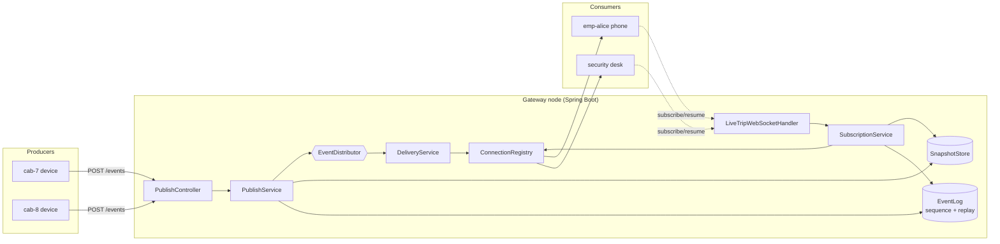

# Architecture

This is the design note: the components, who owns what, the key classes and methods, the main
event flows, and the decisions behind them. Read [CONCEPTS.md](CONCEPTS.md) first if the terms
(ordering, dedup, resume, back-pressure, conflation) are unfamiliar.

## 1. The shape of the system

Two kinds of client, one layer between them:

- **Producers (cabs)** push updates over authenticated **HTTP POST**. A cab is fire-and-forget;
  it needs none of the subscription machinery, so a socket per cab would be waste.
- **Consumers (screens: security desks, admins, employees)** subscribe over **WebSocket** and
  receive an ordered, deduplicated, resumable stream.



## 2. Layering (and why the core is plain classes)

```
web/         REST controllers + the WebSocket handler (transport only, no business rules)
service/     orchestration: PublishService, SubscriptionService, DeliveryService
core/        the algorithms — plain, dependency-free, unit-testable without Spring/web/DB
distribution/ + redis/   the pluggable backbone (in-process | Redis)
repository/  trip ownership store (+ caching decorator)
auth/ error/ metrics/ config/   cross-cutting concerns
```

The case study asks for "the core algorithm in plain classes that can be tested without a web
server or database." That is exactly the `core/` package: `Sequencer`, `EventLog`, `ReplayBuffer`,
`OutboundQueue`, `SubscriptionAuthorizer`, `ClientSequenceTracker`, `SnapshotStore`,
`BoundedTtlCache`. Every one of them is exercised by a JUnit test that `new`s it directly. The web
and Redis layers are thin adapters around this core.

## 3. Topics and the sequence number

**Topics are per cab, per trip and per office** (`TopicType`). A topic is a `(type, id)` pair with
a canonical key like `trip:T-100`. That string is used everywhere: as the sequencer key, the
replay-buffer key, the Redis channel name, and the client-facing subscription key.

One real-world update belongs to several topics. A location for cab-7 on trip-100 in office-BLR-1
is published to **three** topics: `cab:cab-7`, `trip:trip-100`, `office:office-BLR-1`. Each topic
assigns the event **its own** sequence number — this is precisely what "per-topic sequence number"
means. A client subscribed to `trip:trip-100` dedups and resumes using that topic's sequence; a
client on `office:office-BLR-1` uses the office topic's sequence. `TripEvent` is therefore scoped
to one topic: the same logical update (same `eventId`) produces one `TripEvent` per topic.

### Who assigns the sequence, and where

**The server assigns it, atomically, at the single point where an event is accepted for a topic —
before any fan-out.** This is the crux of ordering, dedup and resume, so it is deliberately *not*
two steps (take a number, then append). Taking a number and then appending is a race: two
publishers on one trip could take 5 and 6 but append 6 before 5, leaving the replay log out of
order and silently breaking per-key ordering for every client that later resumes.

So sequencing and appending are one atomic operation, exposed as `EventLog.append(event)`:

- **Single node** (`InMemoryEventLog`): a per-topic lock is held across "increment the counter"
  and "append to the ring". `InMemorySequencer` alone uses a lock-free `AtomicLong`, but the log
  couples the two under one monitor so the stored order always matches the assigned order.
- **Multi node** (`RedisEventLog`): one Lua script runs `INCR` + `RPUSH` + `LTRIM` on Redis.
  Redis executes a script atomically on its single-threaded command loop, so the sequence is
  assigned in exactly one place cluster-wide, with no inter-node coordination, and the log can
  never be left unsorted.

The concurrency test `EventLogConcurrencyTest` hammers one topic from 16 threads × 5,000 appends
and asserts the assigned sequences are exactly 1..80000 — no gaps, no duplicates — and the stored
log is sorted.

## 4. Delivery guarantees

### 4.1 Per-key ordering
Events for one trip are delivered in sequence order. The replay log is stored in sequence order
(§3), and live events are appended in sequence order. The one nuance is the SOS priority lane
(§4.4): an SOS may be *delivered* ahead of queued locations, but every event still carries its true
sequence, so the client orders by sequence. Ordering among **status** events, and the sequence
numbers themselves, are never reordered.

### 4.2 At-least-once + dedup
The server may redeliver (on reconnect, or a Redis pub/sub hiccup). The client turns at-least-once
into exactly-once *effect* by dropping anything whose sequence it has already applied. That rule is
`ClientSequenceTracker` — it lives in `core/` because the reference client, the tests and the load
generator all share it:

```
offer(topic, seq):  seq <= lastSeen  -> DUPLICATE (drop)
                    seq == lastSeen+1 -> ACCEPT
                    seq >  lastSeen+1 -> GAP (accept, but you missed some; resume)
```

### 4.3 Resume (the hardest flow)
On (re)subscribe a client sends its last applied sequence. `SubscriptionService.subscribe` then:

1. **Registers the subscription first**, while holding the connection's write lock. Live events
   begin queueing but cannot be written yet. Registering before reading the replay window is
   deliberate: the reverse order could drop an event that arrives in the gap between reading and
   registering — a silent loss. Registering first can instead deliver an event twice, which dedup
   removes. **Duplicates are recoverable; gaps are not.**
2. Reads `EventLog.replayFrom(topic, lastSeq)`:
   - still inside the bounded window → **REPLAY** the missed events, in order;
   - outside the window (evicted) → **SNAPSHOT**: replay every STATUS/SOS the client missed from
     the **bounded critical history** (kept independently of the location-dominated replay window,
     so a location flood cannot evict it), then send a compact current-state snapshot
     (`SnapshotStore`), then go live. Criticals are sent *before* the snapshot frame, because a
     client treats the snapshot as "you are now current at atSeq" and would otherwise drop them as
     duplicates. If the critical history itself overflowed for this client's horizon, the subscribe
     ack carries `criticalTruncated: true` and a metric fires — the loss is reported, never silent.
   - resume-path frames are marked `"replay": true`, so a client can tell a recovered event from a
     live one (a security desk must not re-sound an alarm for an SOS it is merely recovering).
   - `lastSeq == 0` (fresh subscribe) → snapshot + live.
3. Releases the write lock; queued live events flush in order after the replay/snapshot.

Proven by `ResumeIntegrationTest` (the "phone in a lift" use case) and `ReplayBufferTest`.

### 4.3b Ordered live dispatch (strict per-topic order under concurrent publishing)
Assigning a sequence atomically is not enough on its own: if `distributor.publish` is then called
outside any ordering, two threads publishing to one topic can assign seq 5 and 6 but distribute 6
first, inverting the live wire order. `OrderedDispatcher` fixes this. Topics are partitioned across
`livetrips.publish.dispatch-partitions` single-thread executors (a topic always maps to the same
one), and the atomic unit is **"assign the sequence + enqueue the dispatch"** under a per-partition
lock. That lock spans only in-memory work; the fan-out itself runs later on the partition thread,
**never under a lock**.

- **SOS bypasses the partitions** (`dispatchImmediate`) so it still skips ahead everywhere; its true
  position is preserved by its sequence number and the per-connection express lane.
- **Saturation**: each partition queue is bounded. If it fills, the live dispatch is *dropped* and
  counted (`livetrips.dispatch.dropped`) rather than blocking the publisher — safe, because the
  event is already in the replay log, so the client sees the sequence gap and resumes. A drop never
  permanently blocks a partition.
- **Scope**: strict per-topic live ordering is a **single-node** guarantee (proven by
  `ConcurrentSameTopicOrderingTest` and `OrderedDispatcherTest`). Across nodes, Redis pub/sub does
  not order two nodes' publishes to one topic, so cross-node live order is reconciled by the
  per-topic sequence at the client. **Strict cross-node live ordering is not implemented or tested.**

### 4.4 The outbound queue: back-pressure, conflation, priority — one class
`OutboundQueue` (one per connection) is where three requirements meet. It has **three lanes**:

| Lane | Holds | Policy |
|---|---|---|
| express | SOS | polled strictly first; never dropped |
| critical | STATUS, SNAPSHOT | FIFO; never silently dropped |
| location | LOCATION | **conflated**: a newer position for a cab replaces the older one in place |

- **Back-pressure:** the queue is bounded. Fan-out only ever `offer`s into it and never touches a
  socket, so a frozen consumer absorbs the cost *inside its own bound* and cannot slow anyone else.
- **Conflation:** a lagging client keeps only the latest location per cab, so its location backlog
  is O(cabs watched), not O(events). Status and SOS are exempt.
- **Priority:** SOS is polled before everything, at every drain, so it skips ahead of location
  traffic — the priority lane, enforced in the queue itself.
- **Overflow of a critical event:** if admitting a STATUS/SOS would require losing another critical
  event (the queue is full of them), the queue declares `REJECTED_OVERFLOW` instead of dropping it.
  The gateway then **closes the connection** — which loses nothing, because the client reconnects
  and resumes from the shared replay log. A droppable location into a full all-critical queue is
  simply dropped (`DROPPED_LOCATION`), staying healthy.

Proven by `OutboundQueueTest` and the failure-injection `SlowConsumerIsolationTest`.

### 4.4b The SOS express writer path
A connection drains on a shared writer pool. If every thread of that pool is parked in a blocked
socket write (frozen consumers), a connection holding an SOS has no thread to run its drain. So SOS
also gets a **dedicated express pool**: on offering an SOS the connection schedules a short express
flush that writes *only* the express lane.

It uses `tryLock`, never a blocking lock: if a normal drain already holds the write lock it is
writing this SOS anyway (its `poll()` returns the express lane first), so waiting would only park
express threads behind 256-frame batches. Measured: blocking there was worth ~10 s of SOS p99.
`SosPriorityUnderPoolSaturationTest` proves both halves — the dedicated pool delivers the SOS under
full saturation, and a shared saturated pool starves it.

### 4.5 Draining to the socket without a thread per connection
A thread per connection does not survive 200k connections. Instead each `ClientConnection`
**drain-schedules**: on `offer`, if it has no drain task in flight it submits one to a shared
writer pool; the task writes up to a batch, then reschedules if more remains. A connection occupies
a pool thread only while it actually has bytes to write, at most one at a time. Writes take a
per-connection lock so the subscribe ack + snapshot/replay are emitted before any live event for
that topic — and the lock is per connection, so a slow or mid-subscribe client never blocks another.

Everything is written against a narrow `ClientTransport` seam, not `WebSocketSession`, which is why
the whole pipeline is testable in-process with recording and deliberately-slow transports.

## 5. Scale-out and failure

### 5.1 How an event reaches the node holding a subscriber
`EventDistributor` is the backbone abstraction. A node declares **interest** in a topic when its
first local client subscribes (`onLocalSubscribe`) and drops it when the last one leaves. The
backbone delivers only to interested nodes.

- **In-process** (`InProcessEventDistributor`, default): a direct call. This is why every guarantee
  is testable without a broker.
- **Redis** (`RedisEventDistributor`): each node `SUBSCRIBE`s to the Redis channel for a topic when
  interested. Publishing `PUBLISH`es to that channel; Redis routes it to exactly the subscribed
  nodes. Interest *is* the routing table, maintained by the same subscribe/unsubscribe events that
  create and destroy connections — there is no central "which node holds whom" directory to keep
  consistent.

SOS travels on a **separate channel prefix served by a separate listener container** (its own Redis
connection and dispatch threads), so a burst of location traffic cannot queue ahead of an SOS at
the distribution hop.

### 5.2 Node crash
What makes a crash survivable: the **sequence counter, the replay window and the latest-state
snapshot live in Redis, not in a gateway's heap.** So when a node dies:

1. Its WebSocket connections drop; clients detect the close.
2. Clients reconnect (through the load balancer) to another node.
3. They re-subscribe with their last applied sequence and **resume** from the shared replay log —
   or get a snapshot if they were away past the window.

No status or SOS is lost, because the surviving node reads the same shared log. Proven by
`NodeCrashRecoveryTest` (deterministic) and demonstrated under load by `LoadSimulation` (a node is
killed at T+10s and ~3,600 SOS are delivered afterwards).

## 6. Cross-cutting concerns

| Concern | Where | Note |
|---|---|---|
| **Auth / RBAC** | `JwtService`, `SubscriptionAuthorizer`, `PublishAuthorizer` | HS256 tokens of opaque ids; roles EMPLOYEE / OFFICE_ADMIN / OPERATOR / DEVICE |
| **Tenant isolation** | `SubscriptionAuthorizer` (checked before role) | a tenant mismatch denies regardless of role; checked on subscribe *and* publish |
| **Caching** | `CachingTripMetadataService` + `BoundedTtlCache` | authorization metadata; staleness bounded by TTL, memory by LRU; explicit invalidation |
| **Metrics** | `LiveTripsMetrics` (Micrometer/Prometheus) | SOS p99, queue depth, conflation rate, slow-consumer disconnects, denied subscribes, resume mode |
| **Errors** | `ApiException`, `Errors`, `GlobalExceptionHandler` | stable codes, non-leaking messages, no PII |

See [REQUIREMENTS-MAPPING.md](REQUIREMENTS-MAPPING.md) for each of these mapped to its test, and
[COMPLEXITY.md](COMPLEXITY.md) for the cost analysis and per-connection memory budget.

## 7. Key classes to read first

If you are reviewing the code, read these in order — they are the heart of the system:

1. `core/OutboundQueue` — back-pressure, conflation, SOS priority, overflow (≈ 200 lines, all the hard bits)
2. `core/EventLog` + `core/InMemoryEventLog` — atomic sequencing + bounded replay
3. `service/SubscriptionService` — resume: register-then-replay, snapshot fallback
4. `core/SubscriptionAuthorizer` — tenant isolation and the role matrix
5. `gateway/ClientConnection` — drain scheduling and the write lock
6. `service/PublishService` — trip resolution, multi-topic fan-out, origin timestamping
