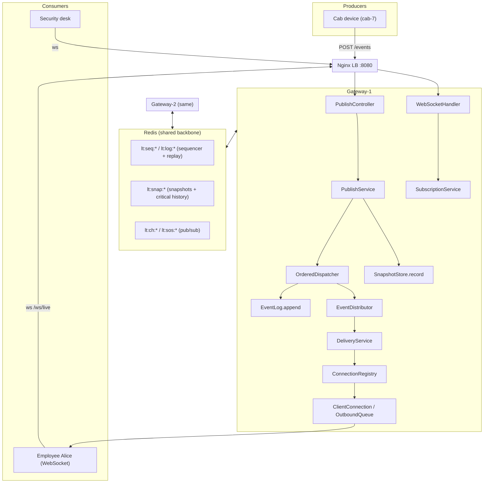
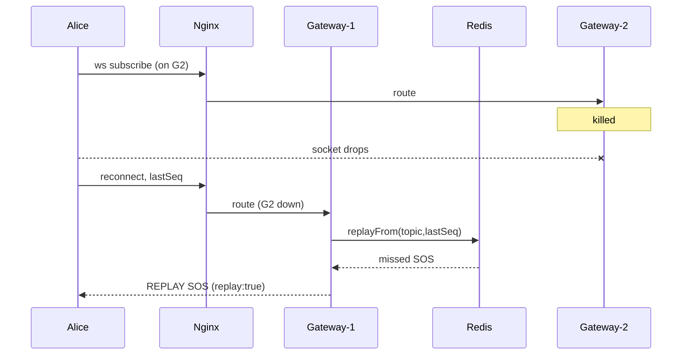

# MoveInSync Case Study 4 — Technical Handover

> Repo: `github.com/pardhuva/MoveInSync` · Package root: `com.moveinsync.livetrips` · 66 main Java files, ~27 test files, 62 automated tests (3 Redis integration tests run only when a Redis is reachable). Verified: `mvnw.cmd clean test` → 62 pass / 0 fail / 0 skip (Redis reachable via Memurai).

## How to read this document
For any claim, the **file path is the source of truth**. "Simulated" = an automated test or the load harness uses an in-process stand-in rather than real network/Redis. "Manual" = works by design and was exercised by hand (Docker), not by an automated test (no Docker on the dev machine).

---

## PART 1 — The problem

**Plain-language example.** A cab (cab-7) is driving employee Alice on trip-100. The cab's device pings GPS every few seconds. Alice watches a live map; a security desk watches every cab in the Bangalore office. If the driver hits SOS, the security desk must see it **within 2 seconds** — even with 20,000 cabs pinging and 200,000 screens connected.

This project is **only the delivery layer**: take each update (LOCATION / STATUS / SOS) and fan it out to exactly the right screens over WebSocket, with the right guarantees. It is **not** a booking app or a map UI.

**Functional requirements (PDF):** topics per cab/trip/office; per-subscription authorization + tenant isolation; per-key ordering; per-topic sequence numbers + at-least-once + client dedup; resume from last seq via bounded replay; snapshot fallback; bounded per-connection queues; location conflation (never drop STATUS/SOS); SOS priority; multi-gateway routing; node-crash reconnect-and-resume.

**Non-functional:** SOS < 2 s always; bounded memory per connection; RBAC; complexity + benchmark; failure handling + ≥1 failure-injection test; monitoring; caching with bounded staleness; no PII in logs; one-command run.

**Scale targets:** 20,000 cabs, 200,000 screens (design); prove ≥10,000 connections + 2,000 cabs with a gateway killed mid-test.

**Hardest challenges (where they live):**
1. Ordering + sequencing under concurrent publishers → `core/InMemoryEventLog.java`, `distribution/OrderedDispatcher.java`.
2. A slow consumer not harming others → `core/OutboundQueue.java`, `gateway/ClientConnection.java`.
3. SOS < 2 s even under load → express lane in `OutboundQueue` + `sosWriterPool` in `ClientConnection` + separate Redis channel.
4. Resume without loss after a crash → `core/EventLog`, `core/SnapshotStore`, `core/CriticalHistory` + shared Redis.

**Guarantees:** per-topic ordering (single-node strict; cross-node reconciled by sequence); at-least-once + dedup; resume-or-snapshot; bounded back-pressure; STATUS/SOS never silently dropped; tenant isolation on subscribe *and* publish.

---

## PART 2 — Technology stack (verified in pom.xml + config)

| Tech | Why | Where (files) | If removed |
|---|---|---|---|
| Java 17+ / Spring Boot 3.2 | DI, WebSocket, actuator, REST | whole app; `LiveTripUpdatesApplication.java` | lose framework |
| spring-boot-starter-web (REST) | cabs publish via HTTP | `web/PublishController`, `AdminController`, `DevTokenController` | cabs couldn't publish |
| spring-boot-starter-websocket (raw, not STOMP) | subscriber transport, full control over queue/priority/resume | `config/WebSocketConfig`, `gateway/LiveTripWebSocketHandler`, `WebSocketClientTransport` | no live push; STOMP would hide queue logic |
| spring-boot-starter-data-redis (Lettuce) | multi-node shared log/snapshot + pub/sub | `redis/*`, `config/RedisDistributionConfig` (profile `redis`) | single-node only |
| Redis (redis:7-alpine / Memurai locally) | shared sequencer, replay log, snapshots, pub/sub | `docker-compose.yml`, `redis/*` | gateways can't share state |
| Nginx (nginx:1.27-alpine) | WebSocket-aware load balancer, failover | `deploy/nginx.conf`, compose `lb` | no single entry/failover |
| Docker + Compose | one-command multi-node run | `Dockerfile`, `docker-compose.yml` | no one-command topology |
| JWT (jjwt 0.12, HS256) | auth; opaque claims | `auth/JwtService` | no authentication |
| Micrometer + Prometheus (actuator) | metrics | `metrics/LiveTripsMetrics`, `/actuator/prometheus` | no observability |
| JUnit 5 + AssertJ + Awaitility | tests | `src/test/...` | no automated proof |
| Maven (+ mvnw wrapper) | build | `pom.xml`, `mvnw.cmd` | no build |

No Lombok (plain classes — deliberate). No DB — `repository/InMemoryTripRepository` is in-memory.

---

## PART 3 — Architecture (reconstructed from code)



**Why each component exists:**
- `PublishController` — HTTP ingress for cabs; validates shape only.
- `PublishService` — authorizes, resolves trip→cab/office/tenant from the record (not the request), stamps origin time, fans one update to trip/cab/office topics.
- `OrderedDispatcher` — guarantees per-topic live dispatch in sequence order without holding a lock across the network fan-out.
- `EventLog` — assigns the per-topic sequence **and** stores to the bounded replay window, atomically.
- `SnapshotStore` — materialized "current state" per topic (latest loc per cab, latest status per trip, active SOS, bounded critical history).
- `EventDistributor` — backbone seam: `InProcessEventDistributor` (default) or `RedisEventDistributor` (profile `redis`).
- `DeliveryService` — offers each event to each local subscriber's `OutboundQueue` (never blocks).
- `ClientConnection` + `OutboundQueue` — per-connection bounded queue (3 lanes), drain to socket, back-pressure, SOS express path.
- `SubscriptionService` — authorizes subscribe, registers interest, replays/snapshots, goes live.
- `ConnectionRegistry` — topic → local connections (local routing table).
- Nginx — WebSocket-aware LB; marks a dead gateway down, routes to survivor.

---

## PART 4 — Source walkthrough (study order)

**Tier 1 — model & contracts**
- `model/EventType.java` — enum with `priority` (SOS 2 > STATUS 1 > LOCATION 0), `conflatable` (LOCATION only), `critical` (STATUS/SOS/SNAPSHOT). Drives the whole pipeline.
- `model/Topic.java` / `TopicType.java` — `(type,id)` → canonical key `"trip:T-100"`. Used as sequencer key, replay key, Redis channel, subscription key.
- `model/TripEvent.java` — immutable event scoped to **one topic** (shared `eventId`, own `sequence`). `conflationKey()` = `"loc:"+cabId` for LOCATION else null.
- `model/TripMeta.java` — ownership record (tripId, cabId, officeId, tenantId, riderUserId).
- `model/TopicSnapshot.java` — latest state container.

**Tier 2 — core algorithms (plain, no Spring)**
- `core/EventLog.java` + `InMemoryEventLog.java` — `append(event)` assigns `nextSeq++` and appends to a bounded `ArrayDeque` **under one per-topic `synchronized` lock** (atomic seq+store); `replayFrom(topic,lastSeq)` → `ReplayResult`.
- `core/ReplayResult.java` — `REPLAY(events, latest)` or `SNAPSHOT_REQUIRED(latest)`.
- `core/OutboundQueue.java` — **crown jewel.** Lanes: `sos` (express), `main` (LinkedHashMap keyed for conflation: STATUS + LOCATION), `locationKeys` (O(1) oldest-location eviction). `offer()` → `ENQUEUED|CONFLATED|DROPPED_LOCATION|REJECTED_OVERFLOW`. `poll()` returns SOS first. **Bound: sos and main each ≤ capacity → worst case 2×capacity.** All methods `synchronized`.
- `core/SnapshotStore.java` + `InMemorySnapshotStore.java` — `record(event)` **sequence-monotonic** (`putIfNewer`); keeps `latestLocationByCab`, `latestStatusByTrip`, `activeSos` (by eventId), `criticalBySeq` (bounded TreeMap = critical history). `criticalEventsAfter(topic,lastSeq)` → `CriticalHistory(events, truncated)`.
- `core/ClientSequenceTracker.java` — client-side dedup: `offer(topic,seq)` → `ACCEPT|DUPLICATE|GAP`.
- `core/SubscriptionAuthorizer.java` / `PublishAuthorizer.java` / `AuthorizationDecision.java` — tenant checked **before** role; `DenyReason` enum.
- `core/BoundedTtlCache.java` — LRU + TTL (injectable clock) for auth metadata.

**Tier 3 — distribution**
- `distribution/EventDistributor.java` (iface: start/publish/onLocalSubscribe/onLocalUnsubscribe/nodeId/describe).
- `distribution/InProcessEventDistributor.java` — `publish()` calls the listener directly.
- `distribution/OrderedDispatcher.java` — N single-thread partition executors + striped locks. `dispatchOrdered(topic, append)` = under stripe lock: run `append` (seq) + enqueue `delegate.publish(sequenced)` on the topic's partition thread. `dispatchImmediate(event)` = SOS bypass. Drop-with-metric on saturation.

**Tier 4 — gateway**
- `gateway/LiveTripWebSocketHandler.java` — builds `ClientConnection`; dispatches `authenticate|subscribe|unsubscribe|ping`; handshake timeout.
- `gateway/ClientConnection.java` — owns `OutboundQueue`, `writeLock`, `draining`/`expressDraining`. `offer()` → queue + `scheduleDrain()` (+ `scheduleExpressDrain()` for SOS). `drain()` on `writerPool`; `expressDrain()` writes only SOS lane on `sosWriterPool` with **`tryLock` (never blocks)**. `sendReplayEventNow()` marks `replay:true`.
- `gateway/FrameCodec.java` — JSON frames: welcome, authenticated, subscribed, snapshot, event, unsubscribed, error, closing, pong.
- `gateway/ConnectionRegistry.java` — topic↔connections.

**Tier 5 — services & web**
- `service/PublishService`, `SubscriptionService`, `DeliveryService`, `CachingTripMetadataService`.
- `web/PublishController`, `DevTokenController`, `AdminController`, `PrincipalArgumentResolver` (Bearer→principal; REST auth guard).

**Tier 6 — redis (profile `redis`)**
- `redis/RedisEventLog.java` — Lua `INCR + RPUSH + LTRIM` (atomic), replay via `LRANGE`.
- `redis/RedisSnapshotStore.java` — Lua compare-and-set monotonic writes; sorted-set critical history.
- `redis/RedisEventDistributor.java` — `convertAndSend` to `lt:ch:<topic>` (or `lt:sos:<topic>`); per-node `SUBSCRIBE` on first local subscriber.

---

## PART 5 — Execution flows (traced)

### Flow A — Authentication
- Token creation: `DevTokenController POST /api/v1/dev/token` (gated by `livetrips.demo.token-endpoint-enabled`, **default false**, on only in `demo` profile) → `JwtService.issue` → HS256 JWT (claims sub, tenant, role, office/cab/trips).
- Verification: REST → `PrincipalArgumentResolver` → `JwtService.bearerToken` → `JwtService.verify` → `AuthenticatedPrincipal`. WS → `LiveTripWebSocketHandler.tryAuthenticate` → same verify.
- Authorization: `SubscriptionAuthorizer` (subscribe), `PublishAuthorizer` (publish). Tenant first; then role (EMPLOYEE owns-trip, OFFICE_ADMIN own-office, OPERATOR tenant-wide, DEVICE publish-own-cab-only / never subscribe).

### Flow B — Publishing a LOCATION
```
POST /api/v1/trips/trip-100/events (Bearer device JWT)
 -> PublishController.publish(principal, tripId, PublishEventRequest)
 -> request.validateForType()
 -> PublishService.publish(principal, PublishCommand)
    -> PublishAuthorizer.authorize(principal, tripId)     (tenant+role; 404 on UNKNOWN/TENANT_MISMATCH)
    -> repository.findTrip(tripId) -> TripMeta            (resolves cab/office/tenant - not trusted from caller)
    -> base TripEvent builder (origin timestamp stamped here)
    -> for each Topic in {trip:T, cab:C, office:O}:
        if SOS:  eventLog.append -> snapshotStore.record -> dispatcher.dispatchImmediate
        else:    dispatcher.dispatchOrdered(topicKey, ()->eventLog.append(...)) -> snapshotStore.record
    -> returns Map{ "trip:trip-100":1, "cab:cab-7":1, "office:office-BLR-1":1 }
```
Inside `OrderedDispatcher.dispatchOrdered`: stripe-lock → `append()` assigns seq → enqueue `delegate.publish(sequenced)` on partition thread → (off-lock) publish runs.

### Flow C — Live WebSocket delivery
```
delegate.publish(event)   [InProcess OR Redis listener]
 -> DeliveryService.onEvent(event)
    -> for conn in registry.subscribers(event.topic()):
        conn.offer(event)
          -> OutboundQueue.offer(event)   (SOS->express | STATUS->main | LOCATION->conflate)
          -> scheduleDrain() (+ scheduleExpressDrain() if SOS)
 -> drain() on writerPool -> OutboundQueue.poll() -> transport.send(FrameCodec.event(e))
 -> Alice receives {"kind":"event","seq":4,"type":"STATUS","replay":false,...}
```

### Flow D — Ordering
- **Scope: per TOPIC** (`trip:`, `cab:`, `office:` each independent, own sequence). "Per-key ordering" = per-trip.
- Sequence atomic in `InMemoryEventLog.TopicLog.append` (`synchronized`, `nextSeq++`) or `RedisEventLog` Lua INCR.
- Live order kept by `OrderedDispatcher` (one partition thread per topic). **Single-node strict; cross-node reconciled by the client's sequence.**

### Flow E — Replay
```
subscribe(conn, "trip:trip-100", lastSeq=4)
 -> authorize -> registry.subscribe + distributor.onLocalSubscribe
 -> eventLog.replayFrom("trip:trip-100", 4)
    -> REPLAY: send subscribed(mode=REPLAY) then sendReplayEventNow(e) for seq>4  (replay:true)
    -> SNAPSHOT_REQUIRED: startFromSnapshot(...)
 -> release write lock -> live events flow
```
Client applies `ClientSequenceTracker`: drops seq ≤ lastApplied.

### Flow F — Snapshot
- `SnapshotStore.record` runs on **every** publish.
- `startFromSnapshot` taken when `lastSeq ≤ 0` (fresh) OR `replayFrom` returns `SNAPSHOT_REQUIRED` (away too long). Sends: subscribed(mode=SNAPSHOT, criticalTruncated) → missed STATUS/SOS from `criticalEventsAfter` (as replay events) → snapshot state frame → live.

### Flow G — Back-pressure
- Each connection has `OutboundQueue(capacity)`. `DeliveryService` only **offers** (never blocks).
- Slow consumer: queue fills; LOCATION conflates; critical overflow → `REJECTED_OVERFLOW` → `closeSlowConsumer()` (lossless, resumes from log). `drain()` on shared bounded `writerPool` (caller-runs).

### Flow H — Conflation & priority
- LOCATION: `main.put(conflationKey, event)` in place (newer replaces older per cab). Metric `conflated`.
- STATUS: critical, FIFO in `main`, never conflated/dropped (overflow → close).
- SOS: `sos` express lane; `poll()`/`pollSos()` first; `scheduleExpressDrain` on `sosWriterPool`; bypasses `OrderedDispatcher`; Redis `lt:sos:`.

### Flow I — Multi-gateway distribution (profile `redis`)
- Publish → `RedisEventDistributor.publish` → `convertAndSend("lt:ch:"+topic, json)` (or `lt:sos:`).
- Interest: a node's first local subscriber to a topic registers a Redis `MessageListener` (bounded `ThreadPoolTaskExecutor` containers). Redis routes each publish only to subscribed nodes → `DeliveryService.onEvent`.
- Shared state: `RedisEventLog` + `RedisSnapshotStore` same keys for all nodes.

### Flow J — Gateway crash recovery
```
Alice on gateway-2 (welcome nodeId)
 -> docker compose kill gateway-2  -> socket drops
 -> SOS published -> nginx routes REST to gateway-1 -> RedisEventLog.append (seq N) in shared Redis
 -> Alice reconnects -> nginx -> gateway-1 -> verify JWT (shared secret)
 -> subscribe(lastSeq) -> RedisEventLog.replayFrom -> REPLAY missed SOS (replay:true)
```
Works because gateways are stateless; truth is in Redis.



---

## PART 6 — Distributed-systems concepts -> how THIS repo does them

| Concept | In this repo | Limitation |
|---|---|---|
| Fan-out | `DeliveryService.onEvent` loops `registry.subscribers(topic)` | O(S) per event per node |
| Per-key ordering | per-topic seq + `OrderedDispatcher` single-thread-per-topic | strict single-node only |
| At-least-once | server replays on reconnect | needs client dedup |
| Idempotency/dedup | `ClientSequenceTracker` + `replay:true` | client must honor it |
| Sequence numbers | `EventLog.append` atomic (lock / Lua INCR) | per topic, not global |
| Replay/resume | `EventLog.replayFrom` bounded window | window = `replay.capacity` (500) |
| Snapshots | `SnapshotStore` + `CriticalHistory` | `activeSos` unbounded in-memory |
| Back-pressure | bounded `OutboundQueue`, offer-only | overflow -> disconnect (recoverable) |
| Bounded queues | `OutboundQueue` 2xcapacity | documented, not single bound |
| Conflation | LOCATION in-place replace by cab | only LOCATION |
| Priority | express lane + `sosWriterPool` + Redis `lt:sos:` | writer pool shared across non-SOS |
| Pub/Sub | Redis channels `lt:ch:*`/`lt:sos:*` | fire-and-forget (log is truth) |
| Multi-instance comms | shared `RedisEventLog`/`SnapshotStore` + pub/sub | **real path not in automated tests** |
| Failure recovery | stateless gateways + Redis + nginx | verified manually (Docker) |
| Tenant isolation | tenant-first checks in both authorizers | — |
| Concurrency | per-topic locks, `synchronized` queue, atomics | — |

---

## PART 7 — APIs & WebSocket protocol

**REST** (JSON; auth = `Authorization: Bearer <JWT>` except dev token):

| Method | URL | Body | Auth | Success | Errors | Code path |
|---|---|---|---|---|---|---|
| POST | `/api/v1/dev/token` | `{userId,tenantId,role,officeId?,cabId?,tripIds?}` | none (demo profile only) | `{token,role,userId,tenantId}` | 400; 404 if profile off | `DevTokenController` -> `JwtService.issue` |
| POST | `/api/v1/trips/{tripId}/events` | `{type,lat,lng,status?,reasonCode?,...}` | Bearer (DEVICE own-cab / OPERATOR) | `202 {topic:seq,...}` | 401, 404 (forbidden+unknown unified), 400 | `PublishController` -> `PublishService.publish` |
| POST | `/api/v1/admin/trips` | `{tripId,cabId,officeId,riderUserId}` | Bearer (OPERATOR/OFFICE_ADMIN) | `200 TripMeta` | 401/403 | `AdminController.registerTrip` |
| POST | `/api/v1/admin/trips/{tripId}/end` | — | Bearer | `200 {tripId,status:ended}` | 401/403/404 | `AdminController.endTrip` |
| GET | `/actuator/health`, `/actuator/prometheus` | — | — | health/metrics | — | actuator |

**WebSocket:** URL `ws://localhost:8080/ws/live` (`WebSocketConfig.addHandler(handler,"/ws/live")`).
- Auth: `Authorization: Bearer` handshake header **or** first frame `{"action":"authenticate","token":"..."}`.
- Subscribe: `{"action":"subscribe","topic":"trip:trip-100","lastSeq":4}`; also `unsubscribe`, `ping`.
- Topic naming: `"<type>:<id>"` -> `trip:trip-100`, `cab:cab-7`, `office:office-BLR-1`.
- Server frames (`FrameCodec`): `welcome{nodeId}`, `authenticated{userId,role}`, `subscribed{mode:SNAPSHOT|REPLAY|LIVE,latestSeq,criticalTruncated}`, `snapshot{topic,atSeq,locations,statuses,sos}`, `event{eventId,topic,seq,type,tripId,cabId,officeId,payload,ts,replay}`, `error{code,message}`, `closing{reason}`, `pong`.

---

## PART 8 — Redis, Docker & deployment

**docker-compose.yml services:** `redis` (redis:7-alpine, AOF on, noeviction, healthcheck), `gateway-1`/`gateway-2` (build: ., `SPRING_PROFILES_ACTIVE: redis,demo`, `REDIS_HOST=redis`, shared `LIVETRIPS_AUTH_JWT_SECRET`, depends_on redis healthy), `lb` (nginx:1.27-alpine, publishes :8080, mounts deploy/nginx.conf).

- Gateway start: Dockerfile multi-stage (build jar -> slim JRE, non-root). Boots in `redis` profile -> `RedisDistributionConfig` wires `RedisEventLog/SnapshotStore/EventDistributor` + two bounded listener containers.
- Nginx: `upstream gateways { least_conn; gateway-1; gateway-2 (max_fails=2 fail_timeout=10s) }`; `/ws/live` sets Upgrade/Connection for WebSocket, 3600s timeouts; `/` proxies REST.
- Redis<->gateways: `RedisEventDistributor` pub/sub + shared `RedisEventLog`/`RedisSnapshotStore` keys (`lt:seq:*`, `lt:log:*`, `lt:snap:*`, `lt:ch:*`, `lt:sos:*`).
- Redis unavailable: Lettuce calls fail; health DOWN; publishes/replays error until it returns. (Not covered by an automated failure test.)
- Gateway restart: stateless — reconnects to Redis, re-subscribes on new client subscriptions; no meaningful local state lost.
- Persisted vs in-memory: Redis holds seq/log/snapshots (AOF). Live WS connections + per-connection `OutboundQueue` are gateway memory (ephemeral, rebuilt on reconnect).
- Key env/config: `LIVETRIPS_AUTH_JWT_SECRET` (shared HS256; verified binds via Spring relaxed binding; no ephemeral fallback), `SPRING_PROFILES_ACTIVE`, `REDIS_HOST/PORT`, `livetrips.replay.capacity`(500), `livetrips.replay.critical-capacity`(256), `livetrips.gateway.queue-capacity`(1000), `livetrips.publish.dispatch-partitions`(16). See `application.yml`, `application-redis.yml`, `application-demo.yml`, `config/LiveTripsProperties`.

---

## PART 9 — Testing, benchmarks, monitoring (honest)

**Tests (62, verified passing).** Key ones:
- `core/EventLogConcurrencyTest` — 16 threads x 5,000 appends -> sequences exactly 1..80000, sorted. Real concurrency test.
- `core/OutboundQueueTest` + `OutboundQueueBoundTest` — priority, conflation, overflow, 2xcapacity bound.
- `core/SubscriptionAuthorizerTest` — tenant isolation incl. required cross-tenant test.
- `integration/NodeCrashRecoveryTest` — two `GatewayHarness` share one in-memory backbone; kill one, resume on the other, no STATUS/SOS lost. **Uses `MultiNodeBus` (test double), not Redis.**
- `integration/ResumeIntegrationTest`, `SnapshotPreservesCriticalHistoryTest`, `SlowConsumerIsolationTest` (failure injection), `ConcurrentSameTopicOrderingTest`, `distribution/OrderedDispatcherTest`, `gateway/SosPriorityUnderPoolSaturationTest`, `integration/TenantEnumerationTest`.
- `redis/RedisEventLogIntegrationTest` (3) — **real Redis**, `@EnabledIf` socket probe; ran this session (7.3s).

**Benchmark — loadtest/LoadSimulation.java:** two `GatewayHarness` share an in-memory backbone via `MultiNodeBus`; 10,000 **in-process** connections (`support/LatencyTransport`, not TCP), 2,000 device publishers, 16 publisher threads, kills node-A at T+10s, reconnects its 5,000 clients to node-B. SOS latency via `support/LatencyCollector.percentile(99)`. **Excludes resume-recovered SOS from live latency.**
- Latest verified run: ~22,000 frames/s, live SOS p99 single-digit–tens of ms (4–153 ms run-to-run), well under 2s.
- p50/p99/max = 50th/99th/100th percentile of SOS samples. p99=X means 99% of samples <= X.
- **Proves:** the application fan-out pipeline sustains target scale and meets the SOS budget *at the pipeline level*. **Does NOT prove:** real 10k TCP sockets, real network RTT, or a real Redis multi-node deployment. Stated in `benchmarks/RESULTS.md`.

**Monitoring — metrics/LiveTripsMetrics (Prometheus):** connections_active/opened, events_published/delivered/conflated/dropped_location, queue_depth, slow_consumer_disconnects, resume{mode}, resume_critical_truncated, sos_express_deliveries, dispatch_dropped, subscribe_ok/denied{reason}, auth_failures, write_failures, delivery_latency{type}. Logs PII-free (opaque ids only).

---

## PART 10 — Design decisions & trade-offs

**Actual decisions (in code):** raw WebSocket not STOMP; cabs over REST not WS; Redis as single backbone; one event -> 3 topics (~3x write amplification; office topic costliest; toggleable via `office-topics-enabled`); drain-scheduling on a shared pool (no thread-per-connection); SOS express pool (measured: dedicated 6–60 ms vs shared 126–140 ms p99 under saturation); critical history separate from replay window.

**Consistency/availability/latency:** favors availability + latency — at-least-once + dedup (not exactly-once); per-key (not global) ordering; pub/sub best-effort with durable log as truth; bounded-staleness auth cache.

**Deliberately left out (docs/TRADEOFFS.md):** real IdP (dev token stands in); persistent DB; strict cross-node live ordering; SOS-acknowledgement flow (so `clearSos` unused); TLS (LB concern); schema versioning.

**Production improvements (recommendations, not implemented):** Redis Streams consumer groups; per-topic Redis sharding for the sequencer; JPA repository; real-socket load test; SOS-ack to bound `activeSos`.

---

## PART 11 — OOP / code design (real examples)

- Interface + implementations (polymorphism, DIP): `EventLog`->`InMemory`/`Redis`; `SnapshotStore`->`InMemory`/`Redis`; `EventDistributor`->`InProcess`/`Redis`; `ClientTransport`->`WebSocketClientTransport`/(test transports); `TripMetadataSource`->`TripRepository`/`CachingTripMetadataService`. Profiles pick the impl (`CoreConfig` `@Profile("!redis")` vs `RedisDistributionConfig` `@Profile("redis")`).
- Encapsulation: `OutboundQueue` hides three lanes behind offer/poll; `TripEvent` immutable Builder.
- Abstraction seam for testing: `ClientTransport` lets the whole pipeline run in-process.
- DI: constructor injection throughout (`config/`).
- Controller/service/repository separation: `web/` -> `service/` -> `core/`+`repository/`.
- SOLID where real: SRP, OCP, DIP. **No behavior inheritance** — composition + interfaces (say this honestly; don't claim a hierarchy that isn't there).

---

## PART 12 — Gaps, risks, verification (evidence-backed)

| Severity | Finding | Evidence |
|---|---|---|
| High | Real multi-gateway live routing is not in any automated test (uses `MultiNodeBus` double; real path only via manual Docker). | no test references `RedisEventDistributor`; `GatewayHarness` uses `MultiNodeBus`. |
| High | Load test is in-process, not real TCP/Redis. Numbers are pipeline latency only. | `LoadSimulation` uses `LatencyTransport` + `MultiNodeBus`. `RESULTS.md`. |
| Medium | `activeSos` unbounded in single-node mode (`clearSos` has no caller). Redis bounds via 24h TTL. | `InMemorySnapshotStore` — put-only. Documented. |
| Medium | Strict cross-node live ordering not implemented (dispatcher is per-node; clients reconcile by seq). | `OrderedDispatcher` Javadoc + `ARCHITECTURE.md`. |
| Medium | Redis-down / partial-failure path untested. | no such test. |
| Low | Two Awaitility integration tests occasionally flake (1 in 7 runs): `NodeCrashRecoveryTest`, `SnapshotPreservesCriticalHistoryTest`. | observed; pass on retry. |
| Low | Dispatch-queue saturation drops live events (recoverable via resume, counted by `dispatch_dropped`). | `OrderedDispatcher` AbortPolicy->onDrop. |
| None(doc) | Queue bound is 2xcapacity, not 1x — correctly documented; not a bug. | `OutboundQueue` + `OutboundQueueBoundTest`. |

**Race/loss/dup analysis:** sequence assignment race-free (atomic). Live wire order under concurrent same-topic publish is strict single-node, reconciled by seq cross-node. Duplicate delivery is expected (at-least-once) and removed by `ClientSequenceTracker`. Loss is bounded: critical overflow -> disconnect+resume; dispatch drop -> resume; beyond critical-capacity -> `criticalTruncated:true` (reported). No critical event silently dropped in the traced paths.

---

## PART 13 — Learning roadmap

For each: open files -> understand methods -> experiment -> checkpoint question.

1. Problem -> PDF + README + docs/CONCEPTS.md. Q: why WebSocket for screens but REST for cabs?
2. Architecture -> docs/ARCHITECTURE.md + SEQUENCE-DIAGRAMS.md. Q: what makes crash recovery possible?
3. Spring structure -> LiveTripUpdatesApplication, config/*. Exp: run SPRING_PROFILES_ACTIVE=demo. Q: how does @Profile choose in-process vs Redis?
4. Auth -> JwtService, SubscriptionAuthorizer, PrincipalArgumentResolver. Exp: publish with no token -> 401. Q: why tenant before role?
5. Publishing -> PublishService.publish. Exp: publish LOCATION, read 3 seqs. Q: why resolve cab/office from the record?
6. WebSockets -> LiveTripWebSocketHandler, FrameCodec. Exp: run WebSocketDemoClient. Q: why authenticate-via-frame?
7. Sequencing/ordering -> InMemoryEventLog.append, OrderedDispatcher. Q: what's the race if append and distribute weren't coupled?
8. Replay/snapshot -> SubscriptionService, EventLog.replayFrom, CriticalHistory. Exp: reconnect old seq -> REPLAY; 0 -> SNAPSHOT. Q: why send criticals before the snapshot frame?
9. Queues/back-pressure -> OutboundQueue, ClientConnection.drain/expressDrain. Q: why tryLock in expressDrain?
10. Redis/multi-gateway -> redis/*, RedisDistributionConfig. Q: how does an event reach the node holding a subscriber?
11. Failure recovery -> NodeCrashRecoveryTest, then Docker kill demo. Q: what state must be in Redis?
12. Testing/benchmarks -> EventLogConcurrencyTest, LoadSimulation, RESULTS.md. Q: what does the load test NOT prove?
13. Trade-offs/production -> docs/TRADEOFFS.md. Q: why at-least-once not exactly-once?

---

## PART 14 — Interview topics (with code evidence)

- Architecture: walk through a LOCATION cab->screen -> Flow B/C.
- Sequencing: who assigns the seq and why atomically -> InMemoryEventLog.append / Redis Lua INCR; cite EventLogConcurrencyTest.
- Ordering scope: per-key = per topic; single-node strict; cross-node by seq.
- At-least-once/dedup -> ClientSequenceTracker, replay:true.
- Back-pressure: one slow client not hurting others -> bounded OutboundQueue, offer-only, overflow->close; cite SlowConsumerIsolationTest.
- SOS < 2s -> express lane + sosWriterPool + tryLock + Redis lt:sos:; cite SosPriorityUnderPoolSaturationTest + A/B numbers.
- Resume vs snapshot -> SubscriptionService, CriticalHistory, criticalTruncated.
- Multi-gateway -> Redis pub/sub + shared log; be honest it's tested via a double + manual Docker.
- Crash recovery -> stateless gateways + Redis; NodeCrashRecoveryTest + Docker demo.
- Concurrency -> per-topic locks, synchronized queue, OrderedDispatcher stripe locks.
- Scalability/limits -> connections-per-node -> add nodes; Redis single sequencer -> shard by topic; in-process benchmark caveat.
- Trade-offs -> docs/TRADEOFFS.md; "never trade a silent permanent loss for a transient visible one."

---

## CONSOLIDATED HANDOVER (for the next AI tutor)

1. Summary: WebSocket pub-sub delivery layer for live cab trips — ordered, resumable, back-pressured, SOS-prioritized, multi-gateway. Java 17 / Spring Boot 3.2.
2. Stack: Spring Boot (web+websocket+actuator), Redis (Lettuce), Nginx, Docker Compose, JWT (jjwt HS256), Micrometer/Prometheus, JUnit5/AssertJ/Awaitility, Maven.
3. Architecture: cabs->REST->PublishService->OrderedDispatcher->EventLog+SnapshotStore+EventDistributor->DeliveryService->ClientConnection/OutboundQueue->WebSocket. Redis = shared seq/log/snapshot/pubsub. Nginx LB over gateway-1/2.
4. Component responsibilities: Parts 3–4 (exact files).
5. Study first: OutboundQueue, InMemoryEventLog, SubscriptionService, PublishService, OrderedDispatcher, ClientConnection, SubscriptionAuthorizer, RedisEventLog.
6. Critical flows: Part 5 (A–J) with method traces.
7. APIs/protocol: Part 7 (4 REST endpoints, WS /ws/live, 9 frame kinds, topic naming type:id).
8. DS mechanisms: Part 6 table.
9. Testing/benchmarks: 62 tests pass; 3 real-Redis tests; load test in-process (not real TCP/Redis) — pipeline latency; live SOS p99 single-digit–tens of ms.
10. Verified limitations/gaps: Part 12.
11. Learning sequence: Part 13.
12. Interview topics: Part 14.

**Honesty rules for the next tutor:** treat `MultiNodeBus` and `LatencyTransport` as test doubles, not proof of real Redis/TCP. The real Redis path is proven only by `RedisEventLogIntegrationTest` (log/snapshot) + the user's manual Docker run. Never describe the load numbers as real-network performance.
