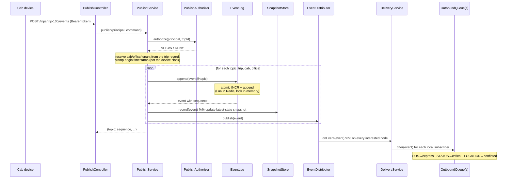
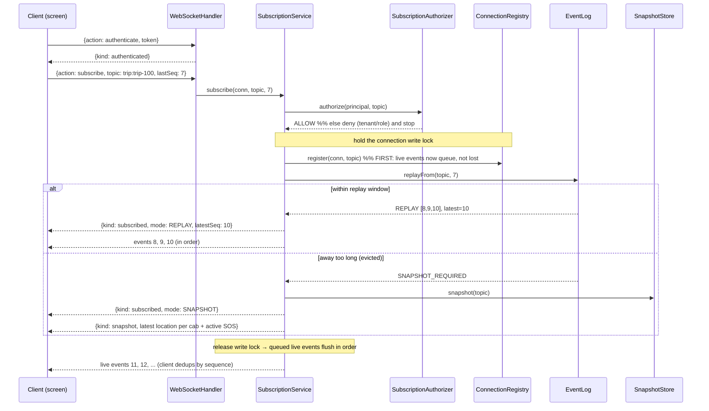
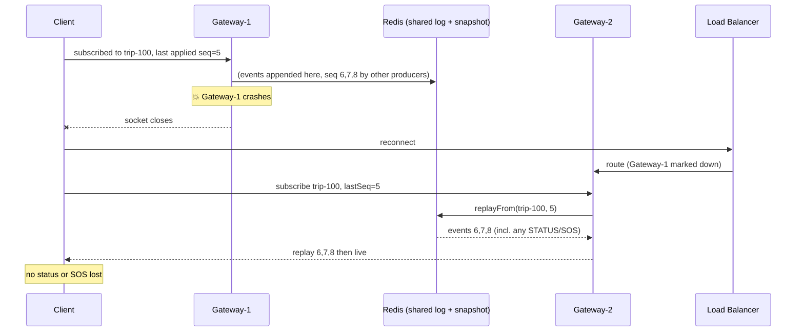

# Sequence Diagrams

Mermaid diagrams for the flows that matter. They render on GitHub.

## 1. Publish → fan-out (the write path)

A cab publishes an update; it is sequenced once per topic and fanned out to subscribers.



## 2. Subscribe + resume (the hardest flow)

The "phone in a lift" case: a client reconnects and must get exactly what it missed, in order.



## 3. Slow consumer + SOS priority (back-pressure under failure)

One desk freezes; its queue fills and conflates, while SOS still reaches every healthy desk fast.

```mermaid
sequenceDiagram
    participant Cab as Cab (flooding locations)
    participant DEL as DeliveryService
    participant QF as Frozen desk queue
    participant QH as Healthy desk queue
    participant TF as Frozen transport (blocked)
    participant TH as Healthy transport

    loop 2000 location updates
        Cab->>DEL: location
        DEL->>QF: offer(location)
        Note over QF: conflated to latest-per-cab<br/>(bounded; never grows)
        DEL->>QH: offer(location)
        QH->>TH: drained to socket
    end
    Note over TF: frozen: its drain thread is blocked on send()
    Cab->>DEL: SOS
    DEL->>QF: offer(SOS) → express lane (bounded)
    DEL->>QH: offer(SOS) → express lane
    QH->>TH: SOS delivered FIRST (<2s), ahead of locations
    Note over QF,TF: frozen desk still stuck, but isolated;<br/>if a critical event can't fit → REJECTED_OVERFLOW → close,<br/>client reconnects and resumes losslessly
```

## 4. Node crash + recovery

A gateway node dies; its clients reconnect elsewhere and resume from the shared backbone.


